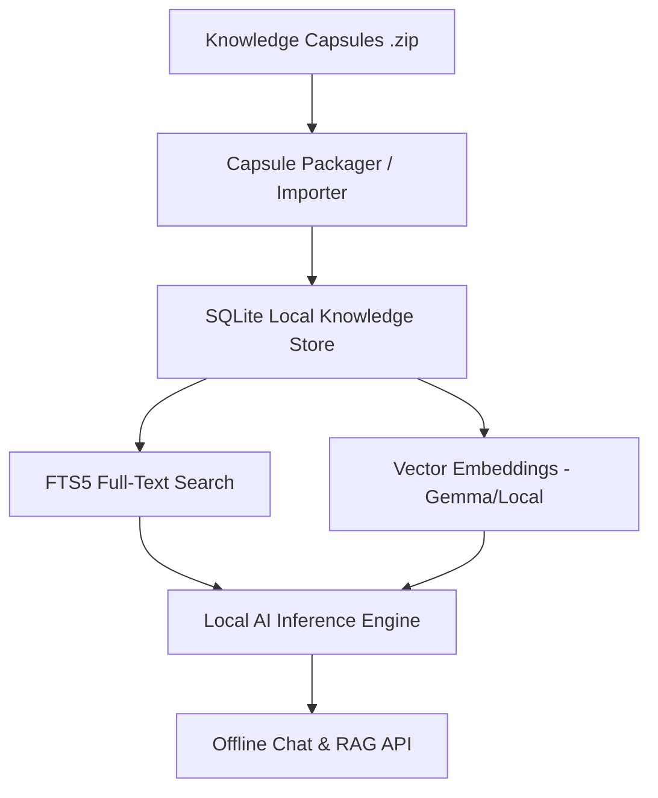

# Resetting World — Knowledge Engine (`rw-knowledge`)

> **Pillar 01 of Resetting World**: Decentralized, offline-first artificial intelligence & modular knowledge capsules.

[](https://opensource.org/licenses/MIT)
[]()
[]()

---

## 🌍 Overview / Visió General / Visión General

**EN**: `rw-knowledge` is a lightweight, zero-cloud RAG (Retrieval-Augmented Generation) runtime designed to operate with zero internet dependency. It embeds structured knowledge capsules (complete technical books, diagrams, metadata) into local vector stores (SQLite + FTS5 + quantized embeddings) capable of running on devices with as little as 4GB-8GB RAM (Raspberry Pi 5, laptops, Android/Termux).

**CA**: `rw-knowledge` és un motor RAG lleuger dissenyat per operar sense cap dependència d'Internet. Empaqueta càpsules de coneixement modulars (llibres tècnics en PDF, diagrames, metadades acadèmiques) en índexs vectorials locals (SQLite + FTS5 + embeddings quantitzats) executables en dispositius de baix consum (Raspberry Pi 5, portàtils, Android/Termux).

**ES**: `rw-knowledge` es un motor RAG ligero diseñado para operar con cero dependencia de Internet. Empaqueta cápsulas de conocimiento modulares (libros técnicos en PDF, diagramas, metadatos académicos) en índices vectoriales locales (SQLite + FTS5 + embeddings cuantizados) ejecutables en dispositivos de bajo consumo (Raspberry Pi 5, portátiles, Android/Termux).

---

## 📦 Core Architecture / Arquitectura



1. **Modular Capsules (`data/packs/`)**: Capped at $\le 50$ vetted technical & survival books per capsule.
2. **Local Vector Engine**: Hybrid BM25/FTS5 keyword search + quantized embedding similarity.
3. **OpenAI-Compatible Local API**: Standard `/v1/chat/completions` endpoint for pluggable client apps.

---

## 🚀 Quickstart

```bash
# Clone the knowledge engine repository
git clone https://github.com/resettingworld/rw-knowledge.git
cd rw-knowledge

# Install dependencies
pip install -e .

# Install a knowledge capsule (e.g. survival pack)
smart-local pack install supervivencia-es-v1.0.0.zip

# Launch local server (default port 8800)
smart-local serve --host 0.0.0.0 --port 8800
```

---

## 📚 Documentation & Governance

- **Capsule Specification**: [`docs/CAPSULE_SPEC.md`](./docs/CAPSULE_SPEC.md)
- **For AI Agents**: [`AGENTS.md`](./AGENTS.md)
- **Contributing**: [`CONTRIBUTING.md`](./CONTRIBUTING.md)
- **Code of Conduct**: [`CODE_OF_CONDUCT.md`](./CODE_OF_CONDUCT.md)
- **Security Policy**: [`SECURITY.md`](./SECURITY.md)
- **License**: [`LICENSE`](./LICENSE) (MIT)

## 🤝 Community & Collaboration
Contributions are open for researchers, librarians, and developers:
- Cataloging open scientific/technical domains.
- Optimizing quantizations for edge ARM64 SBCs.
- Building domain-specific evaluation benchmarks.
